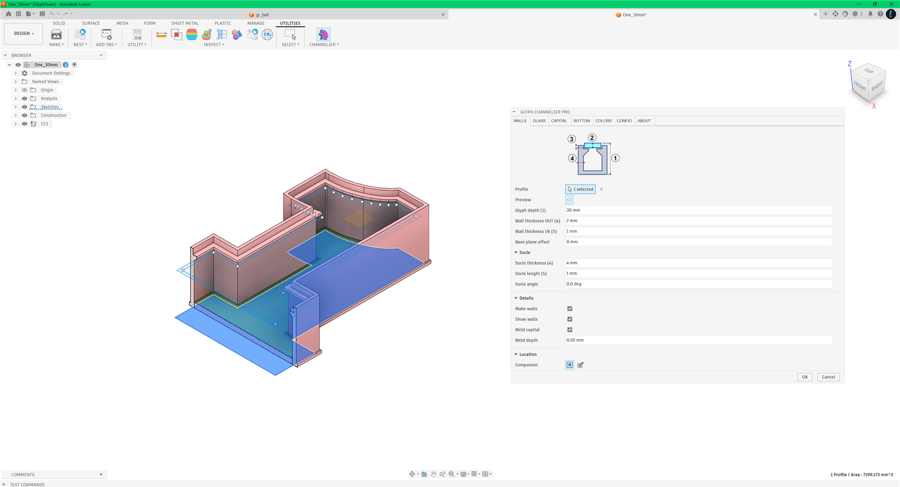

# GlyphChannelier – free samples

Free demo designs, channel profiles and screenshots for **GlyphChannelier**, an add-in for
Autodesk®&nbsp;Fusion&nbsp;360™ that turns DXF/SVG vector shapes into 3D-printable channel letters and signs:
backs, returns, faces and light-guiding parts, ready for LED illumination.

This repository holds no add-in code. It holds material you can use with the add-in, so you
can try the workflow without designing everything from scratch.

## What you find here

- [`objects/`](objects): example DXF shapes, each with its channel profile (JSON) and a screenshot
  of the finished object. Every object folder has its own README.
  - [Corona](objects/corona): a complex shape with many curves and inner parts.
  - [Hope](objects/hope): sharp spikes of the capital, cut off or left sharp.
- [`screenshots/`](screenshots): the add-in in use.

## How to use a channel profile

1. Download the profile file (`.json`).
2. In Autodesk®&nbsp;Fusion&nbsp;360™, start GlyphChannelier, select the **CONFIG** tab and load the profile.
3. Select your vector shape and create the channel letter.

The user manual of the add-in describes every profile value.

## Get the add-in

More about GlyphChannelier, with pictures and help: https://aberamax.com/tools/channelier/glyph-channelier/

GlyphChannelier is available in the [Autodesk App Store](https://apps.autodesk.com/)
(search for "GlyphChannelier"). It runs in Autodesk®&nbsp;Fusion&nbsp;360™ on Windows and macOS.

## License

The content of this repository is licensed under the
[Creative Commons Attribution 4.0 International License (CC BY 4.0)](https://creativecommons.org/licenses/by/4.0/),
see [LICENSE](LICENSE). You may use, change and share it, also commercially, for example in
signs you sell, as long as you give credit:

> "GlyphChannelier samples" by Max Abera, https://github.com/maxabera/glyph-channelier, CC BY 4.0

The license covers the files in this repository, not the GlyphChannelier add-in itself.
The name "GlyphChannelier" is not licensed for use as the name of another product.
Autodesk and Fusion 360 are registered trademarks or trademarks of Autodesk, Inc., and/or its
subsidiaries and/or affiliates in the USA and/or other countries. This repository is not
affiliated with or endorsed by Autodesk.
