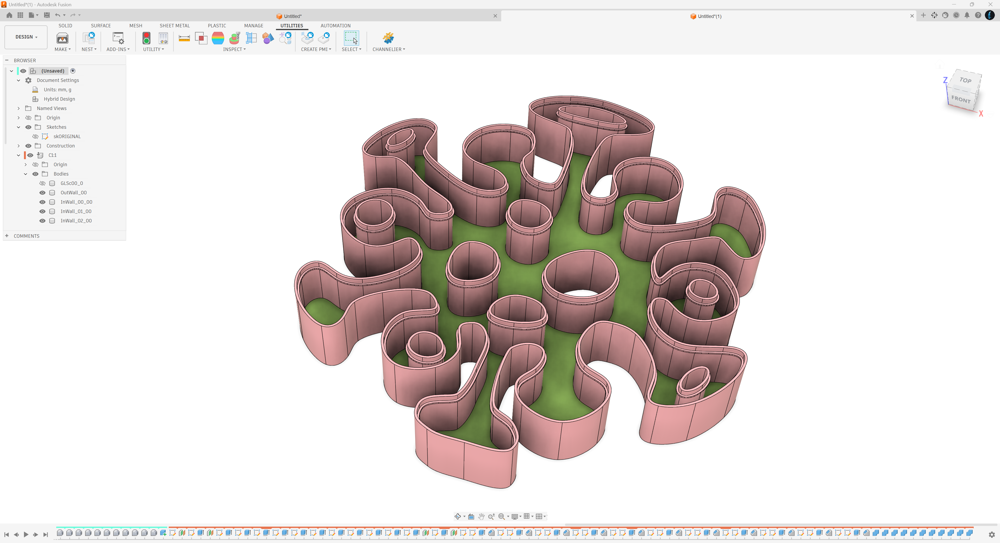

# Corona

A comic-style shape of a coronavirus, inspired by events that went around the whole world.

It's an example of a **complex object**: the outline is made of many curves and the shape has a
large number of inner parts (holes and islands). Use it to see how GlyphChannelier handles
demanding designs, and how long a big extrusion takes on your computer.

> **Note:** with the **Capital** part turned on, the extrusion takes more than 2 minutes.
> Autodesk®&nbsp;Fusion&nbsp;360™ may look frozen during that time. Let it finish.

## Files

| File | Contents |
|---|---|
| `Corona_35.dxf` | Source shape: 196 spline curves, about 302 × 338 mm |
| `Corona-35.json` | Channel profile "Corona 35 cm large – simple settings", load it on the CONFIG tab of the GlyphChannelier dialog |
| `Corona-35.png` | Screenshot of the finished object |

Main values of the channel profile:

| Value | Setting |
|---|---|
| Glyph depth | 40 mm |
| Wall thickness OUT | 1.6 mm |
| Wall thickness IN | 0 mm |
| Bottom thickness | 4 mm |

## How to try it

1. In Autodesk®&nbsp;Fusion&nbsp;360™, insert `Corona_35.dxf` into a sketch.
2. Start GlyphChannelier, select the **CONFIG** tab and load `Corona-35.json`.
3. Select the sketch profile and click **OK**.

## License

[CC BY 4.0](../../LICENSE), "Corona" by Max Abera.
