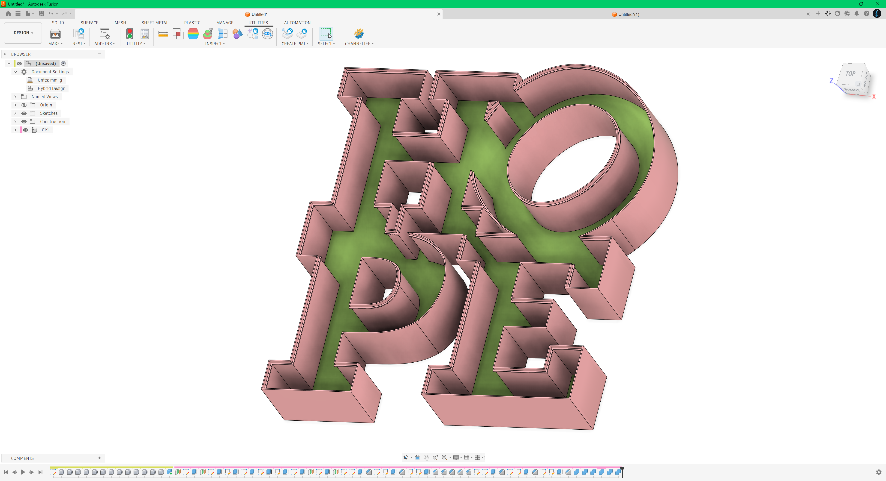
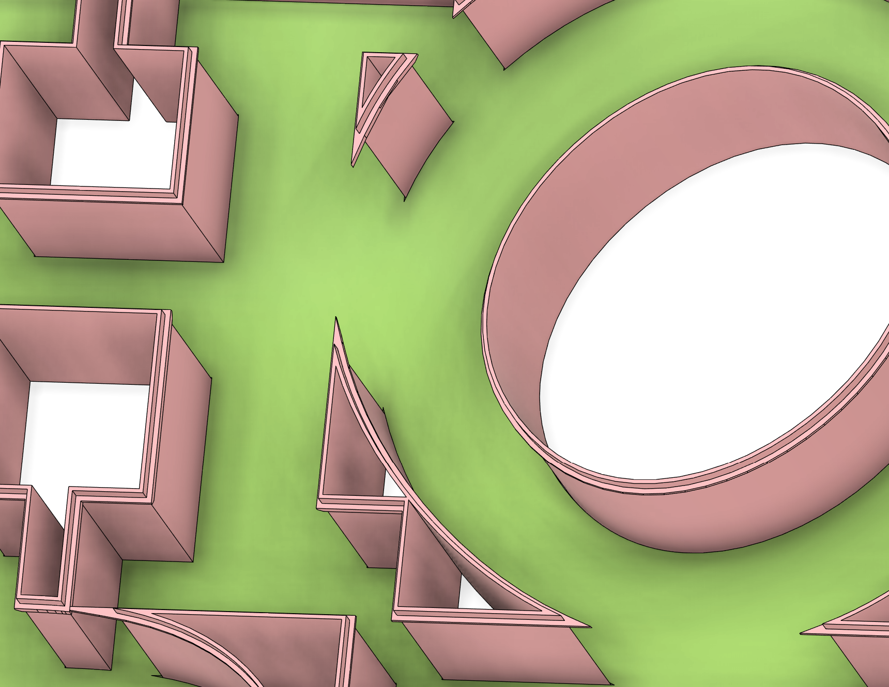

# Hope

The word HOPE, its letters stacked in a square with a tilted O. Where the letters touch, the outline has
many sharp notches with narrow angles.

It shows how GlyphChannelier treats **sharp spikes**. Where the outline has a sharp notch, the capital
edge over the glass becomes a long, thin spike. Such a spike is fragile, hard to print and catches the
light badly. The profile of this object cuts the spikes off.

## Sharp spikes and spikes cut off

<table>
  <tr>
    <th width="50%">Sharp spikes (Spikes: Nothing)</th>
    <th width="50%">Spikes cut off (Spikes: Cut off)</th>
  </tr>
  <tr>
    <td></td>
    <td></td>
  </tr>
</table>

Both pictures show the same part of the object; click a picture to see it full size. Compare the small
piece between the H and the O, the long spike in the middle, where the letters meet, and the corners
along the bottom edge.

## See the difference yourself

The profile has the spikes cut off. To see the sharp spikes, turn the cut off:

1. Open the GlyphChannelier dialog and select the **CAPITAL** tab.
2. In the group **Sharp corners**, set **Spikes** to **Nothing**.
3. Click **OK** and compare the result with the cut-off version.

**Spikes** has a third choice, **Fillet**, which rounds the spikes instead of cutting them. The angles
in the same group select which corners are treated. A corner the treatment does not fit stays sharp.

## Files

| File | Contents |
|---|---|
| `hope-35.dxf` | Source shape (DXF) |
| `hope-35.svg` | The same shape as SVG, about 335 × 350 mm; use the one you prefer |
| `hope-35.json` | Channel profile, load it on the CONFIG tab of the GlyphChannelier dialog |
| `hope-screenshot.png` | Screenshot of the finished object |
| `spikes-cut-off.png` | Screenshot: spikes cut off |
| `with-spikes.png` | Screenshot: sharp spikes |

Main values of the channel profile:

| Value | Setting |
|---|---|
| Glyph depth | 60 mm |
| Wall thickness OUT | 1 mm |
| Wall thickness IN | 0 mm |
| Bottom thickness | 4 mm |
| Spikes (CAPITAL tab) | Cut off |

## How to try it

1. In Autodesk®&nbsp;Fusion&nbsp;360™, insert `hope-35.dxf` or `hope-35.svg` into a sketch.
2. Start GlyphChannelier, select the **CONFIG** tab and load `hope-35.json`.
3. Select the sketch profile and click **OK**.

## License

[CC BY 4.0](../../LICENSE), "Hope" by Max Abera.
